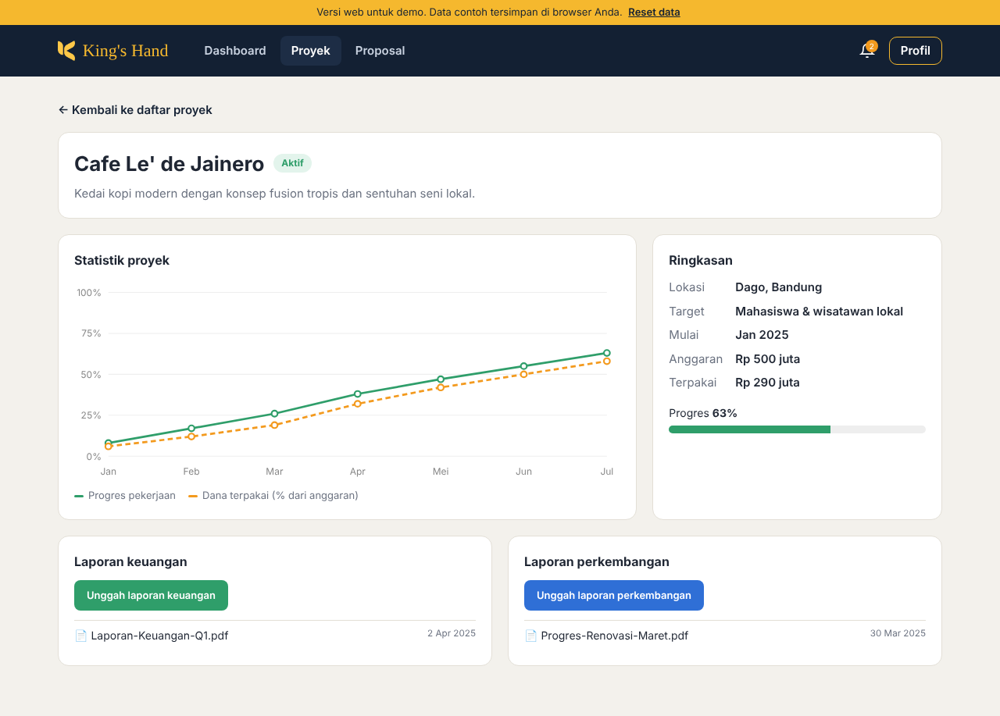

# King's Hand

[](https://github.com/rivaldimhr/KINGSHANDs/actions/workflows/build.yml)

Aplikasi untuk **penanggung jawab proyek** (misalnya proyek sosial atau usaha yang didanai lembaga). Aplikasi ini mencakup alur dari pengajuan proposal sampai pelaporan:

1. **Ajukan proposal.** Isi judul, lokasi, target, dan kebutuhan dana, lalu lampirkan file proposal.
2. **Tunggu evaluasi admin.** Proposal yang disetujui berubah menjadi proyek aktif.
3. **Pantau proyek.** Lihat status, progres pekerjaan, dan dana yang sudah terpakai.
4. **Unggah laporan.** Kirim laporan keuangan dan laporan perkembangan ke admin.
5. **Kelola profil.** Perbarui data pribadi penanggung jawab.

Repo ini berisi dua versi:

| Versi | Isi | Cara mencoba |
|---|---|---|
| **Web (demo)** | `web/index.html`, berjalan di browser dengan data contoh | **https://rivaldimhr.github.io/kingshand/** |
| **Desktop (asli)** | Aplikasi JavaFX hasil Tugas Besar IF2050, data di Firebase | Unduh dari [Releases](https://github.com/rivaldimhr/KINGSHANDs/releases/tag/latest) |

## Versi web




- Masuk dengan akun demo yang sudah terisi: `demo@kingshand.id` / `demo123`.
- Semua data adalah **data contoh**. Perubahan (proposal baru, laporan, profil) hanya tersimpan di browser Anda. Klik **Reset data** di bagian atas untuk mengembalikannya ke awal.
- Unggahan laporan hanya mencatat nama file. Isi file tidak dikirim ke mana pun.
- Evaluasi proposal biasanya dilakukan admin. Di demo, tombol **Simulasikan evaluasi** memerankan admin dengan satu aturan: proposal disetujui jika dananya ≤ Rp 800 juta.

### Cara membaca halaman

- **Dashboard:** jumlah proyek per status (klik kartunya untuk memfilter), proyek terbaru, dan notifikasi dari admin.
- **Detail proyek:** grafik dengan dua garis.
  - Hijau: progres pekerjaan.
  - Oranye putus-putus: dana yang terpakai, dalam persen dari anggaran.
  - Jika garis oranye jauh di atas garis hijau, dana habis lebih cepat daripada pekerjaannya.

## Versi desktop (JavaFX)


### Menjalankan

**Cara cepat:** unduh `KingsHand.zip` dari [Releases](https://github.com/rivaldimhr/KINGSHANDs/releases/tag/latest), ekstrak, lalu jalankan `run.bat` (Windows) atau `run.sh` (macOS/Linux). Butuh **Java 17+**.

**Dari kode sumber** (butuh Java 17+ dan Maven):

```bash
mvn javafx:run          # jalankan langsung
mvn package             # hasil: target/KingsHand.jar
java -jar target/KingsHand.jar
```

JavaFX dan Gson diunduh otomatis oleh Maven, jadi tidak perlu lagi menyiapkan SDK JavaFX atau mengatur path secara manual.

Login memakai Firebase Authentication milik proyek tim (`king-s-hand`). Jika proyek Firebase itu sudah dinonaktifkan, login akan gagal. Gunakan versi web untuk mencoba alurnya.

### Struktur

```
src/
  Main.java, Launcher.java      # titik masuk (Launcher untuk JAR)
  LoginView/Controller.java     # autentikasi
  DashboardView.java            # ringkasan & notifikasi
  ProjectView.java, DetailProject.java
  ProposalView.java, ProfileView.java
  firebase/                     # REST ke Firebase Auth & Firestore
  model/                        # Project, Notification
web/                            # versi web (HTML/CSS/JS tanpa dependensi)
pom.xml                         # build Maven
.github/workflows/build.yml     # CI: build JAR + rilis otomatis
```

## Catatan

- Versi desktop adalah Tugas Besar **IF2050 Dasar Rekayasa Perangkat Lunak** ITB 2025, oleh: Muhammad Daffa Kusuma Atmaja, M Rivaldi Mahari, Regan Adiesta Mahendra, Alfaza Naufal Zakiy, Muhammad Faishal Putra, dan Muhammad Faishal Firdaus.
- Versi web dibuat ulang secara mandiri dari fitur-fitur aplikasi desktop. Datanya data contoh, bukan data proyek sungguhan.
- Banyak tampilan di versi desktop masih memakai data statis (misalnya grafik dan profil). Hanya login dan nama pengguna yang mengambil data dari Firebase.
