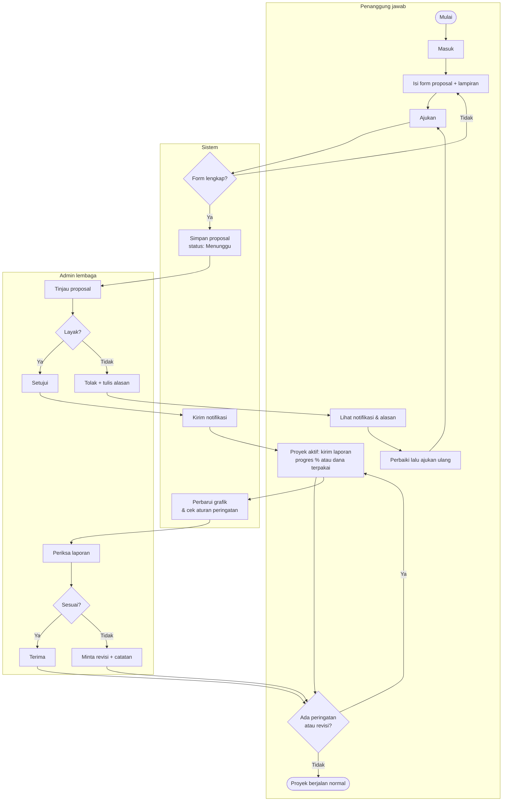
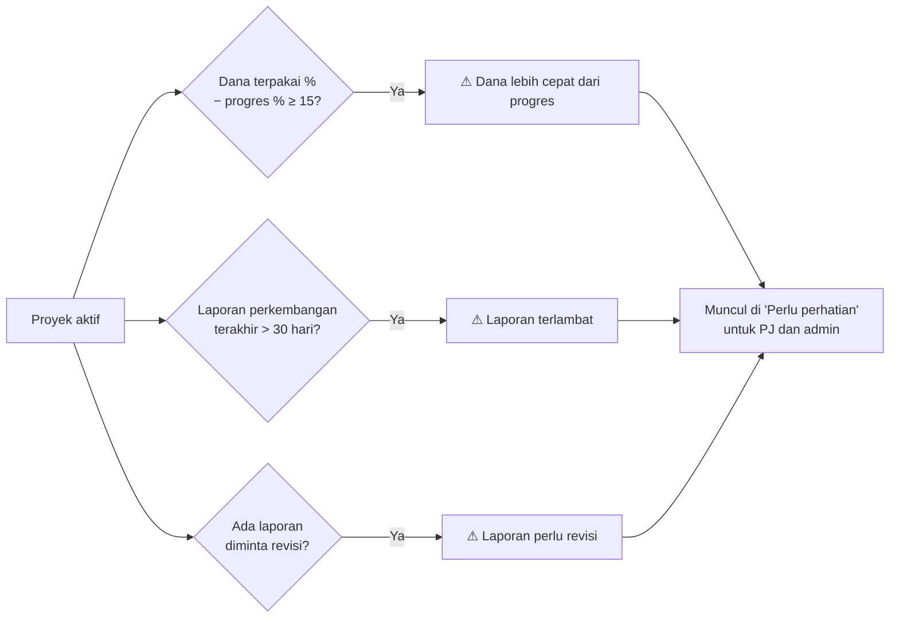
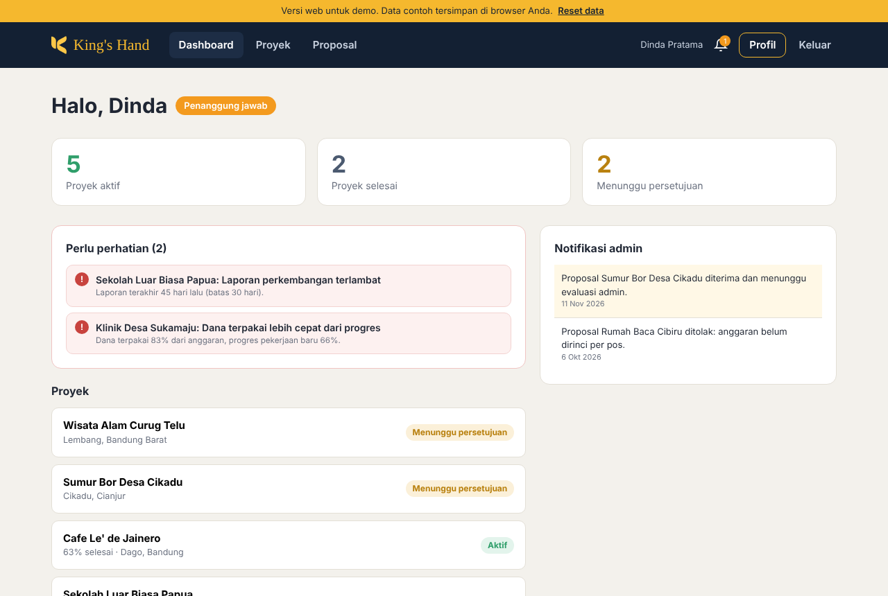
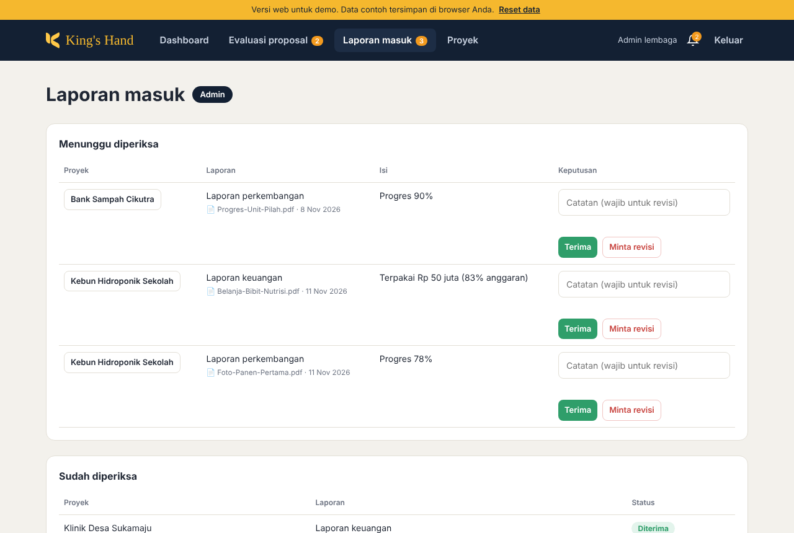
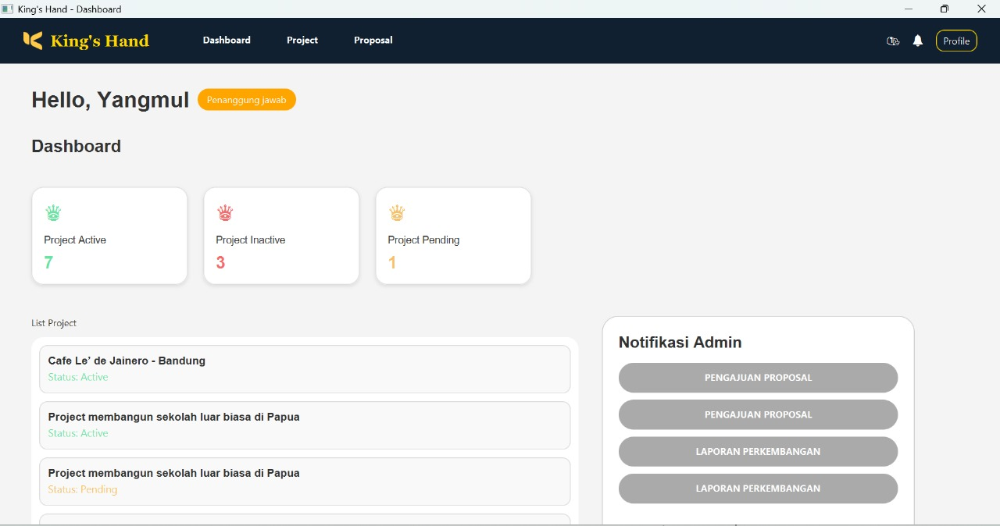

# King's Hand

[](https://github.com/rivaldimhr/KINGSHANDs/actions/workflows/build.yml)

Aplikasi untuk **penanggung jawab proyek** (misalnya proyek sosial atau usaha yang didanai lembaga). Aplikasi ini mencakup alur dari pengajuan proposal sampai pelaporan:

1. **Ajukan proposal.** Isi judul, lokasi, target, dan kebutuhan dana, lalu lampirkan file proposal.
2. **Tunggu evaluasi admin.** Proposal yang disetujui berubah menjadi proyek aktif.
3. **Pantau proyek.** Lihat status, progres pekerjaan, dan dana yang sudah terpakai.
4. **Unggah laporan.** Kirim laporan keuangan dan laporan perkembangan ke admin.
5. **Kelola profil.** Perbarui data pribadi penanggung jawab.

Repo ini berisi dua versi:

| Versi | Isi | Cara mencoba |
|---|---|---|
| **Web (demo)** | `web/index.html`, dua peran (penanggung jawab & admin), peringatan otomatis, 20 test otomatis | **https://rivaldimhr.github.io/kingshand/** |
| **Desktop (asli)** | Aplikasi JavaFX hasil Tugas Besar IF2050, data di Firebase | Unduh dari [Releases](https://github.com/rivaldimhr/KINGSHANDs/releases/tag/latest) |

## Diagram aktivitas

Alur utama aplikasi, dari proposal sampai laporan. Kolom kiri adalah penanggung jawab, kolom tengah sistem, kolom kanan admin.



### Kapan proyek diberi peringatan



## Versi web



Ada dua akun demo, dan tombolnya tersedia di halaman login:

| Peran | Akun | Yang bisa dilakukan |
|---|---|---|
| Penanggung jawab | `demo@kingshand.id` / `demo123` | Mengajukan dan mengubah proposal, mengirim laporan keuangan dan perkembangan, memantau proyek, mengubah profil |
| Admin lembaga | `admin@kingshand.id` / `admin123` | Menyetujui atau menolak proposal (alasan wajib jika menolak), menerima laporan atau meminta revisi, melihat proyek yang perlu perhatian |

Kedua peran memakai data yang sama di browser Anda. Untuk mencoba alur lengkapnya: masuk sebagai penanggung jawab dan ajukan proposal, lalu **Keluar**, masuk sebagai admin dan setujui proposal itu, lalu masuk lagi sebagai penanggung jawab dan lihat notifikasinya.

### Peringatan otomatis

Proyek aktif ditandai **Perlu perhatian** jika:

1. **Dana terpakai lebih cepat dari progres.** Persentase dana terpakai lebih tinggi 15 poin atau lebih dari progres pekerjaan, misalnya dana sudah 83% tapi pekerjaan baru 66%.
2. **Laporan perkembangan terlambat.** Laporan terakhir sudah lebih dari 30 hari.
3. **Laporan perlu revisi.** Admin meminta perbaikan dan laporan itu belum diganti.

Laporan yang dikirim penanggung jawab membawa angka (progres % atau total dana terpakai). Angka itu langsung memperbarui grafik dan peringatan.




### Cara membaca grafik

Grafik di detail proyek punya dua garis:
- **Hijau:** progres pekerjaan.
- **Oranye putus-putus:** dana yang terpakai, dalam persen dari anggaran.

Jika garis oranye jauh di atas garis hijau, dana habis lebih cepat daripada pekerjaannya.

### Catatan demo

- Semua data adalah **data contoh** dan hanya tersimpan di browser Anda. Klik **Reset data** di bagian atas untuk mengembalikannya ke awal.
- Tanggal-tanggal data contoh dihitung mundur dari hari ini, jadi peringatannya selalu tampil sama kapan pun demo dibuka.
- Unggahan hanya mencatat nama file. Isi file tidak dikirim ke mana pun.

### Pengujian

Terdapat 25 test end-to-end (Playwright + pytest) yang mencakup login dan hak akses, alur proposal dua peran, peringatan otomatis, pemeriksaan laporan, validasi form, tampilan ponsel, dan 4 test regresi untuk bug yang ditemukan saat pengujian eksploratif ([laporan bug](https://github.com/rivaldimhr/qa-automation-portfolio/blob/main/docs/bug-reports.md)). Semuanya berjalan di GitHub Actions setiap ada push. Daftar skenario lengkap ada di [docs/TEST_CASES.md](docs/TEST_CASES.md).

```bash
pip install pytest playwright && python -m playwright install chromium
python -m pytest tests/web -v
```

## Versi desktop (JavaFX)



### Menjalankan

**Cara cepat:** unduh `KingsHand.zip` dari [Releases](https://github.com/rivaldimhr/KINGSHANDs/releases/tag/latest), ekstrak, lalu jalankan `run.bat` (Windows) atau `run.sh` (macOS/Linux). Butuh **Java 17+**.

**Dari kode sumber** (butuh Java 17+ dan Maven):

```bash
mvn javafx:run          # jalankan langsung
mvn package             # hasil: target/KingsHand.jar
java -jar target/KingsHand.jar
```

JavaFX dan Gson diunduh otomatis oleh Maven, jadi tidak perlu lagi menyiapkan SDK JavaFX atau mengatur path secara manual.

Login memakai Firebase Authentication milik proyek tim (`king-s-hand`). Jika proyek Firebase itu sudah dinonaktifkan, login akan gagal. Gunakan versi web untuk mencoba alurnya.

### Struktur

```
src/
  Main.java, Launcher.java      # titik masuk (Launcher untuk JAR)
  LoginView/Controller.java     # autentikasi
  DashboardView.java            # ringkasan & notifikasi
  ProjectView.java, DetailProject.java
  ProposalView.java, ProfileView.java
  firebase/                     # REST ke Firebase Auth & Firestore
  model/                        # Project, Notification
web/                            # versi web (HTML/CSS/JS tanpa dependensi)
tests/web/                      # test end-to-end Playwright untuk versi web
docs/TEST_CASES.md              # daftar skenario uji
pom.xml                         # build Maven
.github/workflows/build.yml     # CI: test web, build JAR, rilis otomatis
```

## Catatan

- Versi desktop adalah Tugas Besar **IF2050 Dasar Rekayasa Perangkat Lunak** ITB 2025, oleh: Muhammad Daffa Kusuma Atmaja, M Rivaldi Mahari, Regan Adiesta Mahendra, Alfaza Naufal Zakiy, Muhammad Faishal Putra, dan Muhammad Faishal Firdaus.
- Versi web dibuat ulang secara mandiri dari fitur-fitur aplikasi desktop, lalu ditambah peran admin, peringatan otomatis, dan test otomatis. Datanya data contoh, bukan data proyek sungguhan.
- Banyak tampilan di versi desktop masih memakai data statis (misalnya grafik dan profil). Hanya login dan nama pengguna yang mengambil data dari Firebase.
